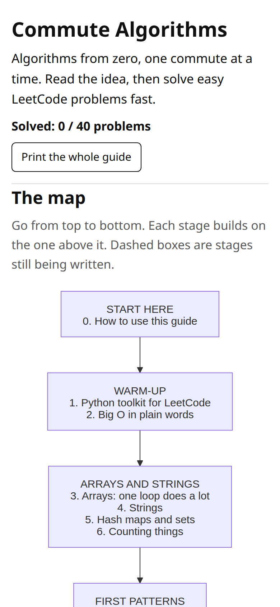

# Commute Algorithms

**Learn algorithms from zero, one commute at a time.**
Short lessons for your phone: read the idea in about 10 minutes, then solve a few easy LeetCode problems, easiest first.

👉 **[pwlae.github.io](https://pwlae.github.io/)**



## Why

Opening random LeetCode problems on the train doesn't get you far. There's no plan, and you can lose a week of rides to one hard problem: the train stops, you lose the thread, and the next ride starts from scratch.

What works is the opposite: **lots of easy problems, solved quickly**, in a sensible order. Step up to harder ones only once the easy ones feel fast.

This site gives the commute that structure.

## How each lesson works

1. **The idea.** A real-life picture and one diagram. Plain words, no walls of text.
2. **In Python.** One small, commented template you can reuse.
3. **Your turn.** 3–6 LeetCode problems, easiest first, each with a time box, a hint and a full solution.
4. **Interesting fact.** Where real systems use it (Git, Linux, databases, browsers, maps…).
5. **Remember.** Three bullets to keep in your head.

The 15-minute rule: stuck for 15 minutes? Open the hint. Still stuck 5 minutes later? Read the solution, then type it yourself. Solve it again tomorrow from memory.

## Built for the Underground

- **Light.** One page, no frameworks, no web fonts, no trackers. Diagrams are pre-rendered.
- **Works offline** after your first visit, so poor signal doesn't matter.
- **Phone first.** Big tap targets, no sideways scrolling.
- **Printable.** Every lesson has a "Print / Save as PDF" button. Hints expand, links are printed, and answers move to the back.
- **Tracks your progress** with "Solved" ticks saved on your phone. No account, nothing sent anywhere.

## What you'll learn

| Stage | Topics |
|---|---|
| Warm-up | Python toolkit for LeetCode · Big O in plain words |
| Arrays and strings | Array scans · Strings · Hash maps and sets · Counting |
| First patterns | Two pointers · Sliding window · Prefix sums |
| Stacks, queues, lists | Stack · Queue and deque · Linked lists |
| Searching and sorting | Binary search · Sorting |
| Recursion and trees | Recursion · Tree DFS · Tree BFS · Binary search trees |
| More tools | Heaps · Greedy · Bit tricks · Math tricks |
| Graphs and backtracking | Graph BFS/DFS · Backtracking |
| Dynamic programming | 1D DP · 2D DP |
| Next level | Topological sort · Union-Find · Dijkstra · Trie |

New lessons are added regularly. Ones not written yet show as "coming soon" on the map. Python only for now.

## Feedback

Found a mistake, a confusing explanation or a broken link? [Open an issue](https://github.com/pwlae/pwlae.github.io/issues). Short notes are welcome. ⭐ Star the repo if you'd like to follow along as new lessons land.

## Building it yourself

The page is generated from `curriculum.json` and one HTML fragment per lesson in `lessons/`.

```sh
pip install pygments
PUPPETEER_SKIP_DOWNLOAD=1 npm install   # Mermaid CLI, build time only
python3 build.py                        # writes index.html and diagrams/*.svg
python3 -m http.server 8765             # preview at http://localhost:8765
```

`python3 tools/check_problems.py <lesson-id>` checks a lesson's LeetCode links (number, title, difficulty, not premium).
